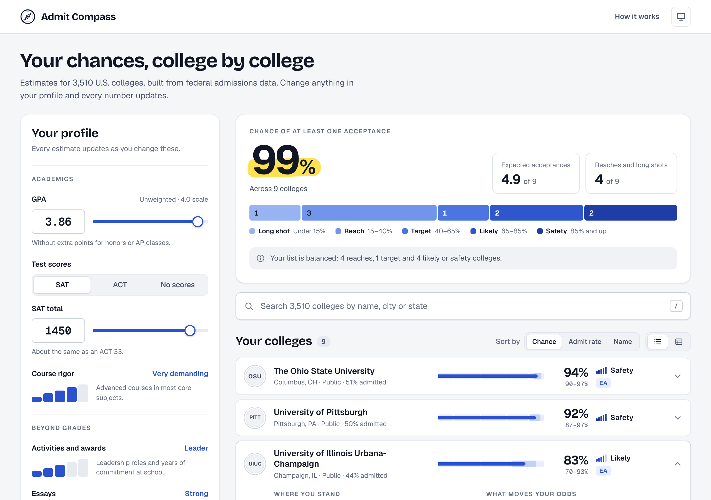

# Admit Compass

Estimate your chances of admission at any of **3,510 U.S. colleges** and build a balanced college list.



Enter your GPA, test scores, course rigor, activities, essays and recommendations, then add colleges. Every
estimate updates as you type, with a likely range, a tier (long shot, reach, target, likely, safety) and a
breakdown of what helps and hurts your odds at that college.

## Features

- **Every U.S. college**: all 3,510 active, degree-granting colleges with undergraduate programs, from the
  Department of Education's IPEDS database. Search by name, abbreviation (MIT, UCLA, UNC), city or state.
- **Honest estimates**: each chance comes with a likely range, and highly selective colleges are never labeled
  safeties, however strong the profile.
- **Why, not just what**: per-college charts show where your GPA and scores sit against the admitted class and
  how many percentage points each part of your application adds or costs.
- **Strategy built in**: early decision and early action, legacy, recruited athletes, first-generation status and
  in-state admission rates at public universities. Tips flag when applying test-optional or early decision
  would raise your odds, and warn about conflicting early applications.
- **List-level view**: chance of at least one acceptance, expected number of acceptances, a tier breakdown and
  advice for balancing the list.
- **Polished on every screen**: light and dark themes, phone layout, keyboard support, screen-reader labels and
  reduced-motion support. Your profile is saved in your browser only.

## Install it on your phone

Once the site is published (see [Deploying to GitHub Pages](#deploying-to-github-pages)), open
**https://brucesweater.github.io/Bruce-the-frist/** on your phone and add it to your home screen:

- **iPhone**: in Safari, tap the Share button, then **Add to Home Screen**.
- **Android**: in Chrome, open the ⋮ menu and tap **Install app** (or **Add to Home screen**).

It then opens full-screen from its own icon, like any other app, and keeps working offline after the first visit.
No App Store, cable or developer account needed.

## How the estimate works

The model in [`src/model/admission.ts`](src/model/admission.ts) is a latent-index model of selective admissions:

1. **Start from the admit rate.** The college admits the top share of its applicant pool, so its admit rate sets
   the cutoff. Public universities use in-state or out-of-state rates.
2. **Place your academics.** GPA, SAT/ACT and course rigor are compared with the middle 50% of enrolled students,
   then translated into a position within the applicant pool.
3. **Weigh the rest.** Activities, essays and recommendations carry more weight at selective colleges, where
   nearly every applicant has strong grades.
4. **Add hooks and timing.** Early decision, legacy, recruited-athlete and first-generation status shift the odds.
5. **Show uncertainty.** A shared uncertainty term produces the likely range and links outcomes across your list,
   so the chance of at least one acceptance is not overstated.

Every tunable number lives in `PARAMS` in that file. Run `npm run calibrate` to print estimates for sample
students across a spread of colleges after changing them.

Estimates are for planning only. The calculator can't read your essays, see your intended major or know a
college's priorities in a given year.

## Data

| Source | What it provides |
| --- | --- |
| [IPEDS](https://nces.ed.gov/ipeds/) (U.S. Department of Education, public domain) | Names, locations, control, enrollment, admit rates, SAT/ACT middle 50%, test policy, open-admission status for every college |
| [`src/data/curated.ts`](src/data/curated.ts) | Hand-checked average GPAs, current test policies, early rounds, legacy policies and in-state/out-of-state admit rates for 147 well-known colleges |

For other colleges, average GPA is estimated from test scores and admit rates (fit on the curated colleges).

### Refreshing the data

1. Download the newest **HD**, **IC**, **ADM** and **DRVEF** "Complete data files" from the
   [IPEDS Data Center](https://nces.ed.gov/ipeds/datacenter/DataFiles.aspx) and unzip them into one folder.
2. Run `npm run build:data -- path/to/that/folder`. This rewrites `src/data/colleges.json`.
3. Run `npm test` to check the result.

## Development

Requires Node.js 22.12 or newer.

```bash
npm install
npm run dev        # start the app at http://localhost:5173
npm test           # run the unit tests
npm run build      # type-check and build the site into dist/
npm run preview    # serve the built site
```

`npm run build:single` builds a single self-contained HTML file in `dist-single/`, handy for sharing a preview.

### Deploying to GitHub Pages

The workflow in `.github/workflows/deploy.yml` publishes the site on every push to `main` once Pages is turned on:
in the repository's **Settings → Pages**, set **Source** to **GitHub Actions**.

## Project structure

```
src/
  model/        admission model, list outlook, rating scales, SAT/ACT concordance (with tests)
  data/         college dataset, curated overrides, search
  components/   profile panel, college search, college list and rows, charts, dialogs
  state/        app state and browser persistence
  styles/       design tokens (light and dark), base and component styles
  fonts/        Geist, Geist Mono and Bricolage Grotesque (SIL Open Font License)
scripts/        data build, model calibration and single-file preview helpers
```
